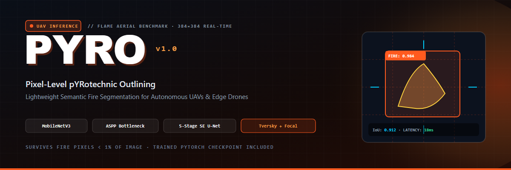
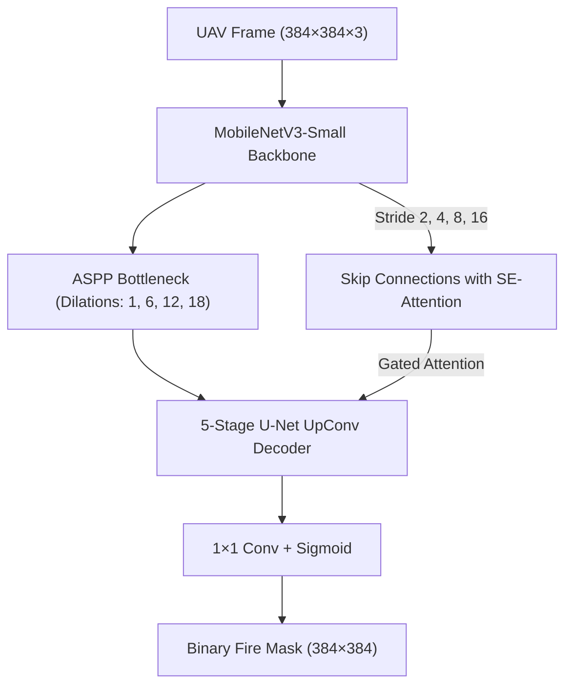
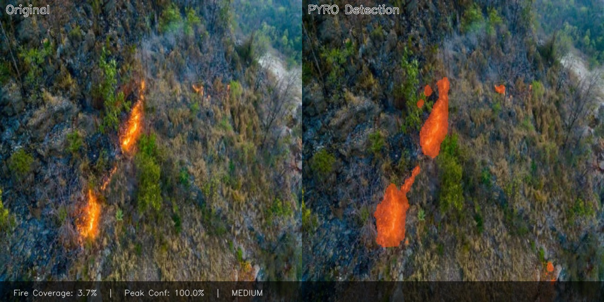
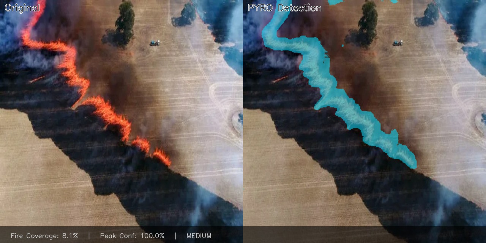

<p align="center">
  
</p>

<h1 align="center">🔥 PYRO — Pixel-Level pYRotechnic Outlining</h1>

<p align="center">
  <strong>Real-time aerial fire segmentation for autonomous UAVs and resource-constrained edge hardware.</strong>
</p>

<p align="center">
  <a href="https://pytorch.org"></a>
  <a href="https://www.python.org"></a>
  
  
  
</p>

<p align="center">
  
  
  
  
</p>

---

## 📑 Table Of Contents

- [What PYRO Is](#what-pyro-is)
- [The Extreme Class Imbalance Challenge](#the-extreme-class-imbalance-challenge)
- [System Architecture](#system-architecture)
- [Compound Loss Formulation](#compound-loss-formulation)
- [Visual Evaluation Results](#visual-evaluation-results)
- [Quickstart & Inference](#quickstart--inference)
- [Repository Structure](#repository-structure)
- [Citation](#citation)
- [License](#license)

---

## 🔥 What PYRO Is

Autonomous aerial monitoring of wildfires poses a severe computer vision challenge: **fire pixels frequently occupy less than 1% of high-altitude drone imagery**, while smoke plumes, sunlight glint, dry red clay, and reflective metal roofs trigger constant false alarms.

**PYRO** solves this with an edge-first neural network engineered specifically for real-time UAV inference:
* **Mobile-First Backbone:** MobileNetV3-Small encoder running with low latency on companion SBCs (Android companion computers, Raspberry Pi 5, Jetson).
* **Multi-Scale Spatial Context:** Atrous Spatial Pyramid Pooling (ASPP) bottleneck captures both isolated sparks and wide fire fronts without spatial resolution loss.
* **SE-Attention Skips:** 5-stage U-Net decoder with Squeeze-and-Excitation channel gating suppresses background landscape noise before concatenation.
* **Extreme Imbalance Handling:** Hybrid **Tversky Loss** (harshly penalizes missed fire false-negatives) + **Focal Loss** (down-weights simple background pixels).

---

## 🧠 System Architecture



### Component Details
| Stage | Component | Function |
| :--- | :--- | :--- |
| **Encoder** | MobileNetV3-Small (Pretrained) | Extracts hierarchical spatial features via depthwise-separable convolutions. |
| **Bottleneck** | ASPP Module | Parallel dilated convolutions with multiple sampling rates for wide receptive fields. |
| **Attention** | Squeeze-and-Excitation (SE) | Channel-wise recalibration that amplifies fire-sensitive features while dampening soil/sun glint. |
| **Decoder** | 5-Stage U-Net | Successive bilinear upsampling with residual skip connections. |

---

## 🎯 Compound Loss Formulation

Standard cross-entropy collapses into a "lazy local minimum" when 99.3% of the image pixels are background. PYRO is trained using a specialized compound objective:

$$\mathcal{L}_{\text{total}} = \mathcal{L}_{\text{Tversky}}(\alpha=0.3, \beta=0.7) + \lambda \mathcal{L}_{\text{Focal}}(\gamma=2.0)$$

* **Tversky Index ($\beta=0.7$):** Places significantly higher penalty on false negatives to guarantee early-stage wildfire ignitions are never missed.
* **Focal Loss ($\gamma=2.0$):** Dynamically scales gradient flow so easy non-fire background pixels do not dominate backpropagation.

---

## 📸 Visual Evaluation Results

Below are real model predictions produced by PYRO on unseen aerial wildfire drone footage:

<p align="center">
  
  
</p>
<p align="center">
  <em>Left: Intense forest fire plume with heavy smoke occlusion. Right: Rapid grassfire line detection across agricultural terrain.</em>
</p>

---

## 🚀 Quickstart & Inference

### 1. Installation
```bash
git clone https://github.com/AhmadHasssan9181/PYRO.git
cd PYRO
pip install -r requirements.txt
```

### 2. Single Image Inference
Generate a binary segmentation mask and blended visualization using pre-trained weights:
```bash
python pyro_inference.py --image path/to/drone_aerial_frame.jpg --weights checkpoints/best_pyro_fire.pth --output_dir ./outputs
```

### 3. Video Stream / Drone Footage
Run inference over recorded UAV flight video or camera RTSP feed:
```bash
python pyro_video.py --video path/to/aerial_flight.mp4 --weights checkpoints/best_pyro_fire.pth
```

### 4. Training on FLAME Dataset
```bash
python pyro_train.py --data_dir /path/to/FLAME --epochs 150 --batch_size 16 --img_size 384
```

---

## 📦 Repository Structure

```text
PYRO/
├── assets/
│   ├── pyro-banner.png                      # High-resolution project banner
│   ├── sunshine-on-the-wildfire-512_pyro.jpg# Real wildfire model inference output
│   └── burning-wheat-fields-512_pyro.jpg    # Grassfire model inference output
├── checkpoints/
│   └── best_pyro_fire.pth                   # Pre-trained production weights
├── pyro_model.py                            # MobileNetV3 + ASPP + SE-UNet architecture
├── pyro_dataset.py                          # FLAME dataloader with Albumentations
├── pyro_inference.py                        # Single-frame inference and mask generation
├── pyro_video.py                            # Video stream processing pipeline
├── pyro_train.py                            # Training loop with compound Tversky-Focal loss
└── utils.py                                 # Metrics calculation and heatmap visualizers
```

---

## 🤝 Citation

Benchmark dataset:
```bibtex
@article{flame2021,
  title={FLAME: Aerial Imagery Pile Burn Detection Using Drones (UAVs)},
  author={Mostafa, et al.},
  journal={IEEE Dataport},
  year={2021}
}
```

---

<p align="center">
  Crafted by <a href="https://github.com/AhmadHasssan9181">Ahmad Hassan</a> • Designed for Autonomous Flight & Edge Autonomy
</p>
